# Perticari Command Center V3 — especificación para aprobación

Revisión: 26 de octubre de 2026, Argentina. Estado: propuesta final para aprobación del propietario. No es una entrega implementada.

Consolida el [diagnóstico de V2](V3_RELEVAMIENTO.md), la devolución posterior y el esquema de familias aportado por Perticari. Los puntos expresamente confirmados se mantienen; las elecciones nuevas se identifican como propuestas incluidas en esta aprobación. Al aprobarse, este documento determina el orden de implementación de V3 y complementa la [especificación general del producto](VERSION_OFICIAL_DEFINITIVA.md).

El objetivo es ampliar la cobertura del catálogo, mejorar ventas y reducir el trabajo del operador. La expansión se mide por productos, medidas y presentaciones comercializables, además de publicaciones activas. No se crean duplicados para alcanzar una cantidad ni se garantiza multiplicar las ventas por cuatro.

## 1. Tres etapas y resultados concretos

| Etapa | Resultado para el propietario | Criterio de cierre |
| --- | --- | --- |
| 1. Mudanza masiva | Elegir familias, revisar excepciones y aprobar lotes completos de publicaciones nuevas o actualizadas. Plantillas comunes y tres imágenes representativas por subfamilia compatible. | Lectura real y repetible del catálogo; cruce con ML; una familia piloto confirmada remotamente; ejecución de los lotes aprobados con resultados por registro y pendientes explicados. |
| 2. Mejora integral, mantenimiento y aprendizaje | Sustituir imágenes en masa, mantener precios, atender consultas con conocimiento validado, cotizar entregas y evaluar campañas con datos reales. | Flujo operativo verificado para cada módulo, historial y fuentes visibles, automatización de precios dentro de una política activada y piloto comercial medido. |
| 3. Herramienta principal de operación | Trabajos rutinarios ejecutados por reglas y una bandeja de excepciones; acceso instalable y avisos importantes fuera de la pestaña abierta. | Operación en segundo plano, alertas probadas, restauración verificada, límites de autonomía efectivos y registro de intervenciones/errores. |

La etapa 1 incluye corregir los bloqueos de integración y la bandeja de preguntas de V2. No espera a completar toda la IA, Maps ni publicidad. Las condiciones mínimas de precio, contenido, disponibilidad comercial y envío sí deben estar resueltas para cada producto que vaya a publicarse.

La misma dirección continúa como acceso de prueba: https://perticari-notificaiones.perticari-sa.workers.dev/app. Los cambios se versionan en GitHub con notas de entrega, pruebas y versión desplegada identificable.

## 2. MEMOSOFT: recorrido de datos y garantía verificable

**Todavía no está demostrado el acceso completo desde el Worker desplegado.** Se identificó un rechazo de nuestro lector al enlace legítimo `/dist/php/login.php?eventual`. Corregirlo es necesario, pero no certifica por sí solo sesión, paginación ni extracción completa. No se puede garantizar la disponibilidad futura de un sitio externo.

Recorrido previsto:

```mermaid
flowchart LR
    A[Horario programado o Actualizar ahora] --> B[Worker: acceso invitado y sesión]
    B --> C[Lectura paginada del catálogo]
    C --> D[Validar SKU, presentación, moneda y precio]
    D --> E[D1: catálogo e historial de cambios]
    E --> F[Avisos y propuestas de publicación o precio]
    F --> G[Aprobación de lote o regla activada]
    G --> H[API de ML y verificación del resultado]
```

El navegador del propietario no necesita permanecer abierto. El servidor conserva la sesión invitada durante la lectura, sin pedir la contraseña de MEMOSOFT. Los scripts Python aportados son referencias del recorrido; no deben ejecutarse en la PC del propietario cada vez que el sistema actualiza.

- Descubrir el número de páginas: el script histórico tenía 111 y la captura actual muestra 112. No fijar ese total en código.
- Registrar identidad de la lectura, páginas, productos válidos/rechazados, inicio, fin y última lectura completa. Validar el formato real del precio y las columnas del HTML, incluyendo posibles celdas ocultas.
- Usar versiones de catálogo: una lectura incompleta no se presenta como completa ni reemplaza automáticamente todo el conjunto vigente. Mantener datos anteriores con su antigüedad visible.
- Un precio ilegible o ausente no es cero; una ausencia de SKU en una lectura parcial no prueba discontinuación ni stock agotado.
- Programación propuesta: lectura completa cada cuatro horas, ajustada después de medir duración/carga, y botón de actualización inmediata. Evitar ciclos superpuestos y dar prioridad a atención/ventas.
- Los cambios generan un aviso persistente con precio anterior/nuevo, fecha y publicaciones vinculadas. El aviso se produce tras detectar el cambio en una consulta exitosa; no implica conocerlo instantáneamente cuando MEMOSOFT lo modifica.
- Investigar si MEMOSOFT dispone de exportación/interfaz autorizada estable. No presumir una API. Si el acceso HTTP no permite leer el catálogo, evaluar esa vía o un lector con navegador antes de prometer disponibilidad automática.
- Mantener importación de Excel como contingencia identificada, con fecha y procedencia. No llamarla sincronización en vivo ni permitir cambios comerciales desde datos vencidos.

**Prueba obligatoria de etapa 1:** desde el entorno de ejecución real, leer el catálogo completo, cotejar códigos y precios representativos, repetir sin duplicar, verificar un cambio mediante un caso controlado y comprobar el comportamiento ante sesión/página fallida. Si el acceso real está bloqueado, documentar la causa; ese requisito permanece abierto. Preparar borradores y contenido puede continuar.

## 3. Familias incluidas y selección del catálogo

El esquema visual se interpreta así: ramas legibles sin tachar incluidas; contenido tachado excluido de esta entrega; variantes con signo de pregunta pendientes de verificación. No inferir el texto oculto. No generar todas las combinaciones posibles entre materiales, formas y medidas: incluir solo productos existentes y respaldados.

| Grupo | Familias y variantes incluidas según la imagen |
| --- | --- |
| Caños de conducción | Negro STD, negro de uso mecánico, galvanizado, epoxi y SCH40. Conservar las denominaciones comerciales y verificar qué representa cada atributo por SKU; no tratarlos automáticamente como categorías excluyentes. |
| Caños estructurales | Cuadrado, redondo, pasamano y rectangular. |
| Chapas industriales | Lisas/negras, gruesas y finas; galvanizadas; semilladas; perforadas. «¿Estampada?» queda pendiente de identificar y confirmar. |
| Chapas de techo | Sinusoidal y trapezoidal T-101; terminaciones/materiales galvanizado, cincalum, plástico y prepintado únicamente cuando correspondan a una referencia real. |
| Obra | Aletado y malla electrosoldada lisa/negra. Malla galvanizada queda pendiente por el signo de pregunta del esquema. |
| Perfiles estructurales | Ángulo, perfil T, IPN y UPN. |
| Perfiles livianos/de techo | CE negro y galvanizado. |
| Macizos | Redondo, cuadrado y planchuela lisa/perforada. El significado de las variantes RED./CUAD. bajo perforada se valida con la ficha antes de generar atributos. |
| Metal desplegado | Expanmetal y escalón, según productos reales del catálogo. |

Resto de herrería, soldadura, rejas, portones y herrajes tachados: fuera del alcance inicial. La clasificación comercial de Perticari se mantiene separada de la taxonomía de ML.

El sistema debe contrastar cada familia con publicaciones actuales y presentar cuatro grupos: vinculadas y correctas, vinculadas para mejorar, faltantes para publicar y excepciones sin datos suficientes. Una coincidencia de título no basta si cambian longitud, unidad, espesor, material o presentación.

Para cada familia se consultan categorías y atributos de ML; se muestran nombres y recorridos, con sus IDs internos. Si aún no hay publicaciones de una familia, se busca una categoría existente adecuada dentro de ML. El sistema no crea categorías globales de la plataforma. La categoría actual de una publicación es evidencia, no prueba de que sea correcta para todos los productos nuevos.

Validar variantes, familias y User Products antes de escribir. No prometer cambiar la categoría de una publicación existente si el modelo de ML no lo admite; proponer el tratamiento compatible conservando los vínculos y explicando cualquier pérdida de historial antes de actuar.

## 4. Descripciones, imágenes y carga masiva

La descripción aportada sirve como base. Se adopta [la plantilla de texto plano](PLANTILLA_DESCRIPCIONES_ML.md), con bloques comunes y variables por producto. La presentación, medidas y atributos también se completan en los campos estructurados de ML; la descripción no los sustituye.

**Tres imágenes iniciales por subfamilia visual compatible:** vista general, detalle de sección/terminación y tercera vista o referencia técnica respaldada. Por ejemplo, no compartir el mismo conjunto entre caño negro y galvanizado o entre chapa sinusoidal y trapezoidal si representa un producto distinto.

- Construir un banco reutilizable con material propio o autorizado de fabricante/distribuidor, registrando procedencia y permiso de uso. No tomar automáticamente fotos de competidores.
- Si falta una imagen fiel, marcar ese conjunto como pendiente. No fabricar fotos que aparenten características, medidas o terminaciones no verificadas para completar una cuota de tres.
- Validar requisitos actuales de imágenes de ML y de la categoría antes de subirlas. No dar por válidos banners, marcas de agua o texto promocional en la imagen principal.
- El propietario revisa una muestra por conjunto de imágenes; luego se reutiliza en los productos compatibles del lote aprobado. Registrar qué publicaciones usan imágenes genéricas y cuáles ya tienen fotos específicas.

**ZIP posterior:** importar imágenes terminadas con una tabla de correspondencia `familia/SKU → archivo → posición`, vista previa, validación y reemplazo masivo supervisado. El sistema debe ofrecer una plantilla descargable de esa correspondencia y mostrar productos sin coincidencia o con conflicto. No es un ZIP cargado directamente a ML.

Si se aportan diseños editables, se selecciona su formato al recibir un ejemplo. Renderizar diseños editables con texto/medidas es una ampliación concreta del motor de plantillas; no afirmar compatibilidad automática con cualquier archivo de diseño. El reemplazo de imágenes terminadas sí queda en el alcance base.

**Flujo de publicación:** seleccionar familias → cruzar con ML → completar datos → calcular precio → asignar categoría/contenido/imágenes → validar cada producto → revisar muestra y excepciones → aprobar lote → ejecutar por API → releer y registrar el resultado. Lotes iniciales de hasta 30, reanudables sin duplicaciones; aumentar el tamaño solo después de medir límites y errores.

El sistema prepara y ejecuta el trabajo repetitivo. El propietario no transcribe filas ni genera un Excel para cada publicación. Las escrituras reales se activan después del piloto y requieren un lote aprobado o una política específica. Un resultado incierto se verifica antes de repetir la solicitud.

## 5. Precios y mantenimiento automático

Precio MEMOSOFT = precio de venta al público. Se conserva **base × 1,15 + cargo fijo aplicable al precio final**, con precisión decimal y resolución de los límites de franja. Los cargos históricos de la conversación se verifican antes de usar escrituras automáticas; no se congelan como tarifas vigentes por aparecer en una captura.

Mantener la vista de cobertura de costos reales del canal. El recargo del 15% no prueba cobertura exacta de una comisión sobre el precio final y no representa margen neto del negocio. No cambiar fórmula, porcentaje ni fuente por decisión de IA.

| Acción | Etapa 1 | Etapas 2 y 3 |
| --- | --- | --- |
| Leer fuentes, comparar y preparar borradores | Automática, con errores visibles | Automática |
| Crear publicaciones | Lotes revisados y aprobados | Continúa por lotes; nuevas reglas de alta requieren activación específica |
| Recalcular precios sugeridos | Automático | Automático |
| Aplicar precios a ML | Aprobación de lote | Automático solo dentro de una política activada y probada |
| Sustituir imágenes/descripciones | Vista previa y aprobación del lote | Vista previa y aprobación del lote |
| Consultar estados y registrar cambios | Automático | Automático |

**Política inicial propuesta para activar el mantenimiento de precios:** producto vinculado sin ambigüedad, misma unidad/moneda, precio de una lectura completa de hasta ocho horas, cargos aplicables verificados, sin promoción o conflicto que altere el precio efectivo, y escritura compatible con el modelo de publicación. Como límites conservadores iniciales: hasta ±5% por cambio y variación acumulada absoluta de hasta 10% en 24 horas. Los movimientos sucesivos se suman; no basta comparar el último precio para eludir el límite.

Esos umbrales son propuestas de esta especificación, no reglas ya autorizadas ni activas. Al aprobar el diseño se implementan como configuración; para activar ejecución automática se muestra y acepta la política concreta tras el piloto. Un cambio fuera de rango, cargo desconocido, fuente vencida, conflicto de promoción o unidad dudosa genera una excepción y conserva el precio publicado. No modificar presupuestos ni precios para competir sin una regla autorizada.

## 6. Atención y aprendizaje

Corregir la reconciliación de pendientes de V2 y registrar por separado búsqueda y consulta individual. Verificar cada pregunta antes del envío, reflejar respuestas realizadas desde ML y distinguir no disponible de respondida. No deduplicar preguntas distintas por compartir texto.

Importar el historial permitido por la API y ofrecer archivos como alternativa. Los 60 días visibles en la web son una referencia de la interfaz, no un contrato garantizado de la API. Organizar ejemplos por intención/familia y retirar tarifas/plazos antiguos de reglas reutilizables.

- Etapa 2: sugerencias con fuentes; validar, corregir o descartar; historial de correcciones; promoción explícita de conocimiento. Cada respuesta generada por IA necesita revisión antes de envío.
- Consultas técnicas: recuperación acotada de fabricantes/fichas/fuentes aprobadas, con fecha y procedencia. No inferir aptitud estructural, propiedades, stock ni plazo sin datos.
- Etapa 3: automatizar, si se activa esa política, respuestas determinísticas de FAQ previamente aprobadas, con condiciones exactas de aplicación. Una clasificación dudosa, texto nuevo generado por IA, reclamo, compromiso de stock o consejo técnico sensible requiere intervención. No se convierte una respuesta enviada en una regla automáticamente.

Esta distinción conserva la aprobación de respuestas de IA y permite reducir trabajo en preguntas rutinarias conocidas. La autonomía no aumenta sola por acumular correcciones. Evaluar contra ejemplos validados y medir aciertos, intervenciones y demoras, no una confianza inventada por el modelo.

## 7. Entregas, zonas y tipo de cambio

**Propuesta de cobertura:** cargar zonas geográficas sobre un mapa, basadas en los recorridos actuales, con direcciones de referencia y excepciones. Usar la ruta vial para verificar viabilidad; no decidir toda la tarifa por radio en línea recta ni por una lista libre de nombres de barrios. Un código postal produce una estimación; cerca de límites o con ubicaciones ambiguas, pedir precisión.

Origen confirmado: San Antonio 1250, Barracas. Base para dibujar y revisar las zonas:

| Acarreo | Tarifa USD confirmada | Referencias del cartel; no límites geográficos definitivos |
| --- | ---: | --- |
| 1 | 20 | Barracas, La Boca, Parque Patricios, Constitución, Avellaneda, Gerli y Sarandí |
| 2 | 39,50 | San Cristóbal, Boedo, Almagro, Retiro, Flores, Lugano, Soldati, Lanús, Escalada y Banfield |
| 3 | 79 | Mataderos, Liniers, Palermo, Chacarita y Lomas |

No interpretar nombres amplios como aceptación automática de todo un partido. Preparar el mapa de cobertura para validación; mientras sus límites no estén aprobados, las nuevas ubicaciones quedan como cotización propuesta. Los radios 8/16/25 km de antecedentes no se activan como regla.

**Fuente de cambio propuesta:** cotización de dólar estadounidense **billete vendedor del Banco de la Nación Argentina**, tomada de su [sitio oficial](https://www.bna.com.ar/Personas). Es una referencia comercial uniforme para convertir estos acarreos, no una afirmación de equivalencia con el indicador de Google ni una cotización fiscal. No intercambiarla silenciosamente con divisa, mayorista, MEP o blue.

- Consulta horaria; conservar valor, unidad, fecha de cotización, fecha de consulta y fuente. El banco no necesariamente publica una cotización nueva en cada consulta.
- Validar el acceso y formato reales antes de activar el adaptador. Desde el entorno de esta revisión el sitio devuelve bloqueo de túnel 403; todavía no hay integración verificada ni se informa un valor actual.
- Conservar la última cotización oficial publicada cuando no haya nueva publicación por fin de semana/feriado, mostrando su fecha. Un fallo de acceso se muestra por separado y no se disfraza de éxito.
- Si no se puede comprobar vigencia para una cotización nueva, mostrar importe estimado con el último dato y requerir confirmación; permitir carga manual identificada con fuente/fecha. No cambiar automáticamente a otro tipo de dólar.
- Convertir la tarifa USD a ARS con redondeo a centavos y guardar los valores usados. No modificar retroactivamente una cotización aceptada por una consulta posterior del dólar. Vigencia comercial de la propuesta: 24 horas, salvo condición específica informada.

Modalidades existentes: más de 300 kg sin cargo dentro de 72 horas y sin mínimo dentro de diez días, dentro de cobertura confirmada y sujeto a compatibilidad con el compromiso de entrega de ML. Para destinos externos, el cliente coordina agencia; Perticari entrega sin cargo en sucursales de La Boca/Barracas, previa aceptación de dimensiones/peso por el transportista. No prometer flete posterior gratuito.

El cotizador interno queda incluido en etapa 2. Antes, etapa 1 conserva cotización manual verificada y condiciones de entrega claras. La visualización de costo por código postal dentro de ML depende de modalidades habilitadas por cuenta/categoría/producto: comprobarlo como integración separada. No prometer un formulario propio insertado en la ficha ni capacidades de checkout no verificadas.

## 8. Publicidad y recomendaciones tras la carga

Consultar estado de publicaciones ayuda a seleccionar candidatos, pero no demuestra rendimiento. Incorporar, según acceso real, visitas, ventas, calidad, consultas y métricas publicitarias, con fechas y atribución. Distinguir productos sin exposición suficiente de productos que reciben tráfico y no convierten.

Propuesta de tres carteras comerciales, que se traducirán a las campañas que permita Product Ads; no son objetivos nativos de API asumidos:

1. **Descubrimiento:** nuevas familias y medidas con fichas completas, para obtener datos de demanda con inversión acotada.
2. **Escala de ganadoras:** publicaciones con evidencia de conversión y costos del canal atendibles; aumentar exposición dentro del presupuesto aprobado.
3. **Oportunidades/estacionalidad:** productos con motivo comercial concreto, disponibilidad confirmada y propuesta competitiva; promociones solo cuando estén verificadas y autorizadas.

No es obligatorio abrir tres campañas desde el primer día ni repartir presupuesto en tercios. Empezar por las carteras que tengan suficientes productos y presupuesto; una publicación tiene un destino publicitario definido para evitar decisiones contradictorias. No prometer retargeting si la cuenta/API no lo ofrece.

Después de cada carga masiva, revisar resultados remotos e informar: altas confirmadas, bloqueadas, imágenes pendientes, productos aptos para campaña y cambios de clasificación cuando exista evidencia nueva. Las nuevas publicaciones no reciben presupuesto automáticamente por haberse creado.

Etapa 2 integra lectura y recomendaciones publicitarias y un piloto autorizado. La modificación por API depende de capacidades comprobadas; cualquier operación disponible solo en el panel de ML queda identificada. Etapa 3 puede aplicar límites y pausas previamente autorizados, sin aumentar gasto total por iniciativa propia. Presupuesto inicial no definido equivale a gasto deshabilitado.

Medir inversión, clics, ventas atribuidas y ACOS/ROAS con ventana de atribución visible. ROAS no es margen neto. Revisar fichas, precio y logística de los productos visitados sin ventas antes de recomendar más inversión.

## 9. Herramienta principal, excepciones y avisos

El inicio muestra qué ocurrió desde la última visita y qué necesita decisión: precios anómalos, preguntas pendientes, disponibilidad de ventas, problemas de publicación, cortes de integración y campañas fuera de regla. Lecturas, cálculo, preparación y comprobaciones rutinarias se ejecutan en segundo plano.

- Mantener pedidos, disponibilidad y seguimiento como parte del flujo principal. La cantidad comercial publicada no se trata como stock físico; la disponibilidad real requiere confirmación mientras no exista una fuente confiable.
- Alertas críticas inmediatas: fuente indispensable vencida, pérdida de acceso, escritura incierta, venta sin disponibilidad confirmada próxima a su plazo operativo, o presupuesto/condición publicitaria fuera de regla.
- Novedades normales agrupadas: cambios de precios, altas, tareas multimedia, sugerencias y resumen de resultados. Deduplicar y permitir reconocer/resolver avisos; evitar un aviso por cada SKU cuando puede resumirse un lote.
- Etapa 3 incluye acceso PWA instalable y notificaciones web push en dispositivos/navegadores compatibles, con permiso del propietario. El historial de avisos permanece en el panel; no se garantiza entrega del sistema operativo. Probar recepción con la pestaña cerrada en el dispositivo elegido.
- WhatsApp continúa como integración opcional separada, con su cuenta, costos y políticas; no bloquea estos avisos ni se promete como disponible.
- Datos de fuentes con última consulta, último éxito, próxima ejecución y cobertura. Mensajes de error con recurso y causa sanitizados, sin tokens ni datos personales expuestos.
- Pausa de automatismos, trazabilidad de acciones, reintentos limitados y comprobación antes de repetir escrituras inciertas. Copias de seguridad y prueba de restauración antes de operaciones masivas.

## 10. Aprobación y condiciones de entrega

La aprobación de esta especificación inicia el desarrollo de las tres etapas en ese orden, preservando la V2 y sus datos. No autoriza por sí sola gastos, campañas ni ejecuciones comerciales masivas sin la revisión de lotes o activación de políticas indicada arriba.

No se requieren nuevamente scripts, catálogos ni secretos. Antes de publicar cada familia se necesita una muestra de imágenes representativas con derecho de uso y completar las excepciones técnicas detectadas. Antes de activar reparto automático se valida el mapa de cobertura; antes de publicidad se define presupuesto. Los interrogantes de la imagen no bloquean las familias confirmadas.

Pruebas de aceptación de la entrega:

1. MEMOSOFT completo y repetible desde el entorno real, con cambios detectados y fallos visibles; no solo pruebas simuladas.
2. Familia piloto: cruce de existentes, faltantes, categoría, descripción e imágenes, precio y logística; ejecución y confirmación remota sin duplicados.
3. Lote repetido/reanudado sin escrituras duplicadas; interrupción y recuperación seguras; respaldo restaurable.
4. Pregunta respondida desde ML y desde el panel reflejada correctamente; sugerencias contrastadas con conocimiento validado.
5. Cambio de precio permitido ejecutado por política; cambio fuera de rango detenido; una fuente vencida no provoca una escritura.
6. Direcciones dentro, fuera y en bordes de zonas; conversión de cambio y cotización aceptada estable.
7. Datos de campaña conciliados con ML cuando haya acceso; gasto y cambios sujetos a límites autorizados.
8. Trabajo programado y aviso importante comprobados sin depender de mantener la interfaz abierta.

Los bloqueos externos se registran como pendientes concretos, con alternativa cuando exista. No se declara una integración terminada por haber construido su pantalla. Las capacidades que ML no ofrezca se explican y su sustitución se acuerda antes de cerrar la etapa correspondiente.
