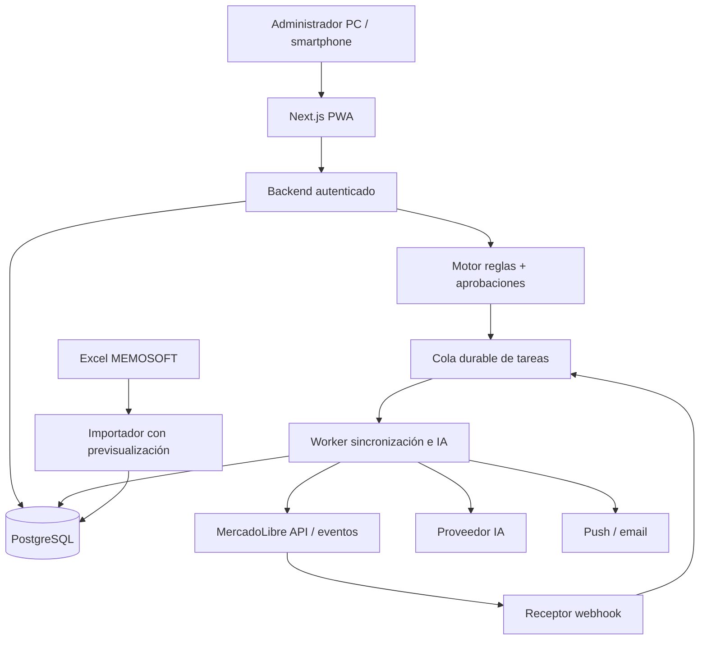

# Arquitectura técnica propuesta — v0.1

## 1. Estilo
**Monolito modular**, un repositorio GitHub privado, una app web Next.js/TypeScript (PWA) y un worker independiente para tareas persistentes; PostgreSQL como almacenamiento transaccional. Infraestructura cloud por defecto **propuesta**, pendiente de costo y autorización. Evitar microservicios, clusters y componentes costosos para el volumen inicial.



`Push` y `email` son mecanismos de notificación; la app debe ser útil aunque no se hayan concedido permisos push.

## 2. Módulos del backend (bounded contexts)
1. `identity`: login/MFA, sesiones, permisos internos.
2. `integrations/mercadolibre`: OAuth, refresh, scopes, wrappers HTTP, rate limit, webhooks, feature flags y versionado de APIs. Nadie fuera de este módulo llama directamente a ML.
3. `imports/memosoft`: mapeo flexible de columnas, validación, archivos, staging y reconciliación.
4. `catalog`: familias, productos, SKU, conversiones, presentaciones, publicaciones externas y media.
5. `conversations`: preguntas preventa, estados, asignación, borradores, respuestas, motivos de revisión.
6. `knowledge`: documentos con procedencia, FAQ aprobadas, búsqueda y sugerencias de cambio.
7. `pricing`: precios base, cambio ARS/USD, costos variables, comisiones, escenario, límites y simulaciones.
8. `logistics`: modalidades, zonas, tarifas, cobertura validada, cotizaciones y excepciones.
9. `growth`: ventas, visitas, ads, indicadores, intervenciones y recomendaciones.
10. `operations`: acciones propuestas, aprobaciones, ejecuciones, errores, retries, scheduler, notificaciones, auditoría.

## 3. Modelo de datos lógico (sujeto a exportaciones reales)
- `User(id, email, mfaEnabled, status, createdAt)`
- `SalesChannel(id, type, accountExternalId, status)`
- `ExternalCredential(id, channelId, encryptedAccessToken, encryptedRefreshToken, expiresAt, version)`; prohibido exponer en API JSON al cliente.
- `ImportBatch(id, filename, sha256, source, status, createdAt, appliedAt)`
- `ImportRow(id, batchId, rawJson, normalizedJson, validationStatus, errorsJson)`
- `Family(id, code, name, parentId?)`
- `Product(id, familyId, internalCode, name, technicalAttributesJson)`
- `Sku(id, productId, sku, baseUnit, nominalWeight?, nominalLength?, qualityStatus)`
- `CommercialPack(id, skuId, sellingUnit, quantityPerPack, length?, weight?, unitFactor, packagingStatus)`
- `PriceSource(id, skuId, valueDecimal, currency, vatIncluded, source, validAt, batchId)`
- `ProcurementCost(id, skuId, valueDecimal, currency, vatIncluded, validAt, batchId)`
- `FxRate(id, pair, rateDecimal, source, validAt, approvedAt, approvedBy)`
- `Listing(id, channelId, externalItemId, externalUserProductId?, skuId?, packId?, categoryId, listingType, state, priceDecimal, currency, lastRemoteSeenAt)`
- `ListingVariation(id, listingId, externalVariationId?, externalUserProductId?, skuId, attributesJson)`
- `MediaAsset(id, familyId?, skuId?, type, storageKey, checksum, metadataJson)`
- `Question(id, channelId, externalQuestionId UNIQUE, externalItemId, text, externalStatus, arrivedAt, syncedAt)`
- `AnswerDraft(id, questionId, content, sourceRefsJson, warningsJson, authorType, status, updatedAt)`
- `AnswerSendAttempt(id, questionId, draftId, idempotencyKey UNIQUE, remoteStatus, attemptedAt, resultJson)`
- `KnowledgeEntry(id, type, text, source, reviewedBy?, approvedAt?, version, status)`
- `FreightZone(id, name, geometryType, geometryJson?, localitiesJson?, verifiedAt?, status)`
- `FreightTariff(id, zoneId, amountUsdDecimal, validFrom, validTo?, approvedAt?)`
- `PriceRule(id, scopeType, scopeId, formulaType, paramsJson, effectiveAt, approvalStatus, version)`
- `PriceSimulation(id, inputSnapshotHash, resultsJson, mode, status, createdAt)`
- `Operation(id, type, targetId, requestSnapshot, approvedBy?, approvedAt?, status, createdAt)`
- `OperationAttempt(id, operationId, idempotencyKey UNIQUE, responseMetadata, status, attemptedAt)`
- `WebhookEvent(id, channel, externalEventId UNIQUE, receivedAt, payload, processStatus)`
- `Job(id, type, dedupKey UNIQUE, payload, status, attempts, nextRunAt, lockedAt)`
- `MetricSnapshot(id, metricType, scopeId, periodStart, periodEnd, value, source, retrievedAt)`
- `AuditEvent(id, actor, action, entityType, entityId, diffJson, timestamp, correlationId)`

### Puntos de modelado críticos
- SKU interno se mantiene como identificador de negocio, **pero la PK interna usa ID independiente**. Un SKU puede tener múltiples presentaciones y/o publicaciones; no asumir relación uno-a-uno.
- Las presentaciones comerciales no son necesariamente variaciones permitidas por una categoría de ML.
- Conservar el crudo de cada importación en staging, no convertir el primer Excel en la única fuente.
- Moneda `ARS` o `USD` + `decimal`, jamás `float` para precios o cantidades relevantes.
- Distinguir `Unknown`, `Estimated`, `Confirmed`, `Stale` en stock, logística, tarifas, rentabilidad y fuentes.
- Guardar snapshots externos e historial de cambios para depuración y conciliación.

## 4. Integración MercadoLibre
- OAuth 2.0 Authorization Code en servidor, `state`, redirect exacto, scopes mínimos, tokens almacenados cifrados. Si está habilitado, implementar PKCE. No compartir claves en Codex o archivos.
- El refresh token es rotativo/de un solo uso: diseñar renovación **bajo lock transaccional** por cuenta para evitar múltiples refrescos concurrentes.
- Para recepción de eventos: validar procedencia según capacidad documentada, persistir event envelope, responder rápido, procesar con worker y reconciliar preguntas por API. Proteger contra reentregas y eventos fuera de orden.
- Polling de recuperación periódico: la recepción por webhook no sustituye comprobación contra el estado de ML.
- Capa adaptadora de `Listing/Variation/UserProduct`; usar capacidades detectadas por cuenta y categoría. No suponer mutaciones disponibles.
- API de costos de venta: `listing_prices`, con parámetros de moneda, categoría o catalog product, listing type, shipping mode, logistic type, billable weight donde corresponda. `sale_fee_amount` incluye cargo fijo, no sumar `fixed_fee` dos veces.
- API Product Ads vigente: conservar ad_group_id y no programar endpoints legados retirados en 2026. Guardar métricas regularmente para retención propia.
- Respetar cuotas/rate-limit y backoff para 429, errores 5xx y timeouts; evitar scraping no autorizado.

## 5. Estado de operaciones externas
`DRAFT → VALIDATED → REQUIRES_APPROVAL / RULE_APPROVED → QUEUED → RUNNING → CONFIRMED | PARTIAL | FAILED | REQUIRES_RECONCILIATION`

Una operación de escritura registra valor inicial, intención, versión/fecha del recurso y respuesta de la API. Si hay timeout después del POST, **consultar estado remoto antes de reintentar** para no duplicar envíos. Un fallo en uno de 100 SKUs no anula los otros 99: informe de éxito parcial, reintentos selectivos y no mentir sobre atomicidad.

## 6. Asistente de atención
Pipeline: `Pregunta → obtener datos de publicación → buscar conocimiento validado → detectar faltantes/contradicciones → generar una propuesta breve → reglas de seguridad y hechos verificables → guardar borrador → humano edita y confirma → verificar pregunta aún abierta → enviar por API → confirmar y auditar`.

- Prompts de sistema/instrucciones de producto fuera de la data del cliente; el texto del comprador es **entrada no confiable**. No dejar que instrucciones en preguntas gobiernen el modelo.
- Respuestas históricas: solo fragmentos relevantes y con estado aprobado; guardar fuente y vigencia.
- IA no consulta secretos/tokens ni modifica precios/stock.
- Se recomienda devolver JSON interno `{suggestedText, evidenceIds[], warnings[], missingFields[], mustReview}`; backend verifica esquema y longitud.
- PII: persistir historial según política acordada, pero compartir con IA únicamente fragmentos estrictamente necesarios, en lo posible desidentificados.
- No entrenar automáticamente con preguntas/respuestas, las propuestas de FAQ se someten a aprobación.

## 7. Infraestructura, operación y protección de datos
- Entornos separados y secretos separados. No conectar staging con una cuenta productiva capaz de escribir salvo piloto expresamente autorizado.
- Worker/cron 24/7; cola respaldada por DB inicialmente (solución técnica concreta a elegir tras probar volumen y despliegue). Evitar una arquitectura que dependa de la PC prendida para notificaciones.
- PWA push (service worker, suscripción por dispositivo) y correo fallback; dedupe por question_id; tener en cuenta que las restricciones de navegador/SO pueden impedir entrega instantánea.
- HTTPS, cookies `HttpOnly/Secure/SameSite`, CSP, rate limit, CSRF cuando corresponda, MFA y gestión de sesiones.
- Cifrado de campos sensibles y almacenamiento de secretos del proveedor. Backups diarios **con restore drill** y almacenamiento fuera del mismo punto de falla.
- Observabilidad mínima: logs estructurados sin PII/tokens, heartbeat del worker, antigüedad del último sync, errores y acción de reintento controlado.
- Titularidad personal de hosting y repositorio: exigir autorización empresarial escrita para operar, acuerdo de custodia/tratamiento y plan de transferencia/revocación. No mezclar credenciales de ML de la empresa con cuentas personales sin habilitación.

## 8. Propuesta de organización del repo
```
apps/
  web/                 # Next.js (admin + API routes si se elige)
  worker/              # procesos event-driven y cron
packages/
  domain/              # tipos, reglas puras, casos de uso
  db/                  # schema, migrations, repositories
  integrations/        # MercadoLibre, MEMOSOFT, email, IA
  ui/                  # componentes reutilizables
  test-fixtures/       # simulaciones SIN secretos ni PII
infra/                 # configuraciones y scripts de deploy
specs/                 # SRS, ADR, backlog, decisiones
```
No es obligatorio un monorepo multi-app si el despliegue elegido recomienda una forma más simple. Mantener módulos separados conceptualmente.

## 9. Deuda deliberada / decisiones pospuestas
Proveedor de hosting, servicio DB, ORM, librería de auth/MFA, servicio de email, web push, cola concreta, object storage, CDN, costo y políticas de retención. Elegir después de validar presupuesto, requisito 24/7 y titularidad.
